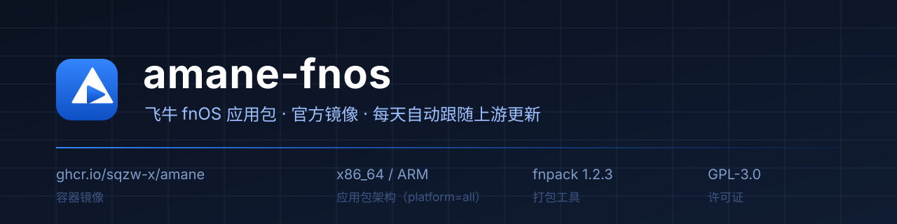

# amane-fnos

[](https://github.com/frilxy/amane-fnos/actions/workflows/build.yml)
[](https://github.com/frilxy/amane-fnos/releases)
[](LICENSE)

把上游 [amane](https://github.com/sqzw-x/amane)（AI 时代的私人影库）的官方 Docker 镜像
打包成飞牛 fnOS 可安装的 `.fpk`，并每天自动跟随上游更新。

| | |
| --- | --- |
| 镜像 | `ghcr.io/sqzw-x/amane`（上游官方，amd64 / arm64） |
| 架构 | x86_64、ARM（ARM 未实机验证） |
| 体积 | 约 38 KB，不含镜像；镜像安装后由 NAS 上的 Docker 拉取 |

## 安装

下载 `amane.fpk`：`https://github.com/frilxy/amane-fnos/releases/latest/download/amane.fpk`

1. 应用中心 → 手动安装 → 选该文件。向导填端口（默认 8000）、代理可留空。
2. 应用设置 → **授权目录** → 授权媒体文件夹（保存即生效）。
3. 浏览器打开 `http://<NAS>:<端口>`，API Token 见「应用文件 → amane → data → token」。

首次启动要拉镜像（数百 MB）。更多见 [docs/USAGE.md](docs/USAGE.md)。

## 更新

- 上游发版 → GitHub Actions 自动出包并发布 Release（每天北京时间 06:00 检查上游 tag 与镜像 digest）。
- **不会自动装到 NAS**：下载新 `amane.fpk` 覆盖安装即可，数据库、授权、端口、代理全部保留。
- 版本号 = 上游版本，仅打包改动时追加序号（`0.19.0` → `0.19.0.1`）。
- 每版 Release 正文与应用的「更新说明」都会带上该版本的上游更新记录，不用再猜改了什么。

## 注意

- **容器名固定 `amane`**：之前手工跑过 amane 的话请先 `docker compose down`，否则应用的容器创建不出来。
- 授权目录即时生效；**端口 / 代理改动需要重建容器**，应用会自己重建，失败时日志会给出命令。
- 应用里「选择路径」无法从 `/` 逐级点进卷（fnOS 只给授权目录本身读权限），
  直接手输绝对路径即可；本包默认让选择器落在授权目录里。
- 拉不动 `ghcr.io` 时配代理或用 `image-override`，见 [docs/USAGE.md#网络与代理](docs/USAGE.md#网络与代理)。

## 排障

```bash
sudo bash tools/doctor.sh    # 体检：容器来源/身份/挂载/授权/端口，并给出修复命令
```

更多见 [docs/TROUBLESHOOTING.md](docs/TROUBLESHOOTING.md)。

## 开发

```bash
make check    # 校验（scripts/validate-fpk.sh）
make fpk      # 本地打包到 dist/（用官方 fnpack）
```

CI：`build.yml` 校验并构建；`release.yml` 每天检查上游，有变化才出包。
改 `fpk/**` 或 `scripts/**` 会在下次定时运行时重新出包，只改文档不会。

## 许可

GPL-3.0（与上游一致，包内包含上游图标资源）。
应用本身的功能 / 刮削问题请反馈到[上游](https://github.com/sqzw-x/amane/issues)，打包与 CI 问题在本仓库提 Issue。
