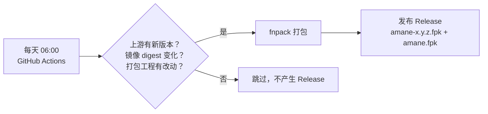
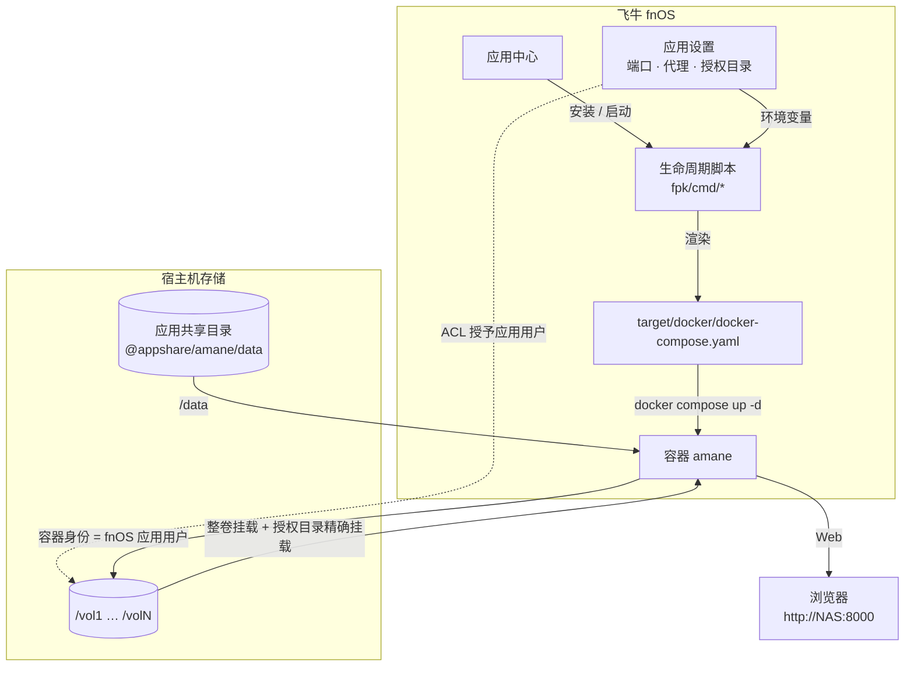

# amane-fnos

[](https://github.com/frilxy/amane-fnos/actions/workflows/build.yml)
[](https://github.com/frilxy/amane-fnos/actions/workflows/release.yml)
[](https://github.com/frilxy/amane-fnos/releases)
[](LICENSE)


把上游 [sqzw-x/amane](https://github.com/sqzw-x/amane)（AI 时代的私人影库）的**官方 Docker 镜像**
打包成飞牛 fnOS 可以直接安装的 `.fpk` 应用包，并**每天自动检查上游更新**，有新版就自动出包、发 Release。

> Packaging for [sqzw-x/amane](https://github.com/sqzw-x/amane) on 飞牛 fnOS: build a `.fpk` around the
> upstream official image, and publish a new package automatically whenever upstream ships a release.
> The app itself is upstream's; this repository only contains the packaging project and its CI.


| 项目 | 值 |
| --- | --- |
| 应用包名 | `amane` |
| 容器镜像 | `ghcr.io/sqzw-x/amane:<上游标签>`（上游官方多架构镜像） |
| 架构 | `platform = all`：x86_64 与 ARM（**ARM 未实机验证**） |
| 最低系统 | fnOS `1.1.3100` |
| 打包格式 | `docker-project` + `data-share`，由 fnOS 官方 `fnpack` 生成 |
| 许可证 | GPL-3.0（与上游一致，包内含上游图标资源） |

## 目录

- [这是什么](#这是什么)
- [快速开始](#快速开始)
- [更新与升级](#更新与升级)
- [授权与权限边界](docs/AUTHORIZATION.md)
- [网络与代理](docs/NETWORKING.md)
- [自动更新机制](#自动更新机制)
- [架构与数据流](#架构与数据流)
- [仓库结构](#仓库结构)
- [本地构建](docs/DEVELOPMENT.md#本地构建)
- [排障](docs/TROUBLESHOOTING.md)
- [常见问题](#常见问题)
- [参与与反馈](#参与与反馈)
- [许可与致谢](#许可与致谢)

## 这是什么

Amane 是一个本地优先的私人影库：自动监控磁盘、聚合多源元数据刮削、目录整理、图片超分、
自然语言检索片库，并带海报墙 Web 界面。上游提供 macOS / Windows 桌面版与 Docker 镜像；
本仓库负责把 **Docker 镜像**变成 fnOS 应用中心可以「手动安装」的 `.fpk`。

包本身**不含镜像与二进制**（约 38 KB，只有 manifest、图标、生命周期脚本、向导与一份 compose），
几百 MB 的镜像在安装后由 NAS 上的 Docker 从 `ghcr.io` 拉取。

### 特性

- **官方镜像**：容器直接用 `ghcr.io/sqzw-x/amane`，不自行构建，避免与上游行为漂移。
- **自动跟随上游**：每天北京时间 06:00 检查上游标签与镜像 digest，有变化才出包。
- **授权目录即时生效**：容器按卷挂载 `/vol1`…`/volN`，fnOS 授权目录的 ACL 在宿主机侧立刻生效，
  新增/取消授权不需要重启应用；容器身份就是 fnOS 应用用户，未授权目录读不到。
- **配置变更自动重建**：端口、出网代理、授权目录改动后，生命周期脚本自己 `docker compose up -d`
  完成重建，无需 SSH。
- **数据持久**：数据库、Token、刮削结果、缩略图都放在应用共享目录
  （`/vol*/@appshare/amane/data`），在「文件管理 → 应用文件」里可见可备份，卸载默认保留。
- **状态探测双通道**：`docker inspect` 优先，docker 不可用时回退探测 `/api/health`，不误报未运行。
- **x86_64 + ARM**：纯脚本包 + 上游多架构镜像。

## 快速开始

```text
下载（固定文件名，永远指向最新发布）：
https://github.com/frilxy/amane-fnos/releases/latest/download/amane.fpk
```

1. 打开 fnOS「**应用中心 → 手动安装**」，选择下载好的 `amane.fpk`（需要 Docker 运行时可用）。
2. 安装向导填写 **Web 访问端口**（默认 `8000`）和可选的 **出网代理**（例如 `http://host.docker.internal:7890`）。
3. 安装完成后进入「**应用设置 → 授权目录**」，把你的媒体文件夹（例如 `/vol1/media`）授予 Amane 并保存
   —— 授权**即时生效**，直接在 Amane 里选路径即可。
4. 首次登录：浏览器打开 `http://<NAS 地址>:<端口>`，API Token 见
   「文件管理 → 应用文件 → amane → data → token」，或执行 `docker logs amane`。

> 端口、代理、授权目录的改动都会由生命周期脚本重新生成 `docker-compose.yaml`，不需要手工编辑任何文件。
> 详细步骤、升级与卸载见 [docs/INSTALL.md](docs/INSTALL.md)。

### 支持矩阵

| 能力 | 状态 | 说明 |
| --- | --- | --- |
| x86_64 | ✅ 已验证 | 本仓库 CI + 真机安装 |
| ARM | ⚠️ 未实机验证 | 上游镜像提供 `linux/arm64`，包内无架构相关二进制 |
| 授权目录 | ✅ | 整卷 + 精确挂载，读写由 fnOS ACL 决定 |
| 出网代理 | ✅ | 向导填写，写入容器 `HTTP_PROXY/HTTPS_PROXY/ALL_PROXY` |
| 一键升级 | ⚠️ 手动 | 第三方 fpk 不在应用商店，需下载新包手动安装 |
| 自动更新 | ✅ | 上游发版 → 自动出包并发布 Release |

## 更新与升级

- **`.fpk` 只有几十 KB 是正常的**：包里没有镜像，镜像在安装/启动时由 Docker 拉取；
  改一行脚本就能重发一版，仓库也不会膨胀。
- **升级方式**：下载新的 `amane.fpk`，在应用中心手动安装覆盖即可（走升级流程）。
  数据库、Token、刮削结果、缩略图都在 data-share 里，授权目录、端口、代理设置也都保留；
  新包只是把 compose 里的镜像 tag 换成新版本，启动时 Docker 拉新镜像，Amane 自己完成数据库迁移。
- **不会自动升级**：第三方 fpk 不在飞牛应用商店里。想省事就订阅本仓库的 Releases
  （Watch → Custom → Releases）。
- **版本号只前进**：上游发版 → `0.19.0`；只有打包工程变动 → `0.19.0.1`、`0.19.0.2`。
  重复安装同一版本没有意义。

## 自动更新机制

`.github/workflows/release.yml` 有三个触发源：**定时**（`0 22 * * *` UTC = 北京时间每天 06:00）、
**手动**（Actions → 构建并发布 fpk → Run workflow，可指定上游版本或强制重建），
以及推送 `v*` 标签（立刻发一版）。



判定依据（任一命中才出包）：

1. 上游 `vX.Y.Z` 标签变化 → fpk 版本 = `X.Y.Z`
2. 同一版本但 GHCR 镜像 digest 变了（上游重推 tag）→ `X.Y.Z.1`
3. `fpk/**`、`scripts/**` 的打包指纹变化 → 版本顺延
4. 手动勾选 `force`

上游只在打 tag 时才推 GHCR 镜像，所以包的更新节奏与上游发版一致。
若希望跟到上游 `main` 的未发布提交，需要改成由 CI 自行构建镜像并推送，当前实现没有这么做，
以保持包体积与构建时间可控。更多细节见 [docs/DEVELOPMENT.md](docs/DEVELOPMENT.md#发布流程)。

## 架构与数据流



三层边界（最终能不能读写由内核 ACL 决定）见 [docs/AUTHORIZATION.md](docs/AUTHORIZATION.md)。

## 仓库结构

```text
.
├── fpk/                          # fnOS 应用包工程（fnpack 的输入）
│   ├── manifest                  # 应用元信息；version/changelog 由 CI 注入
│   ├── ICON.PNG / ICON_256.PNG   # 64 / 256 图标（取自上游 assets/app.ico）
│   ├── config/
│   │   ├── privilege             # run-as=package，应用用户 amane，join-groups=[docker]
│   │   └── resource              # docker-project + data-share(amane/data)
│   ├── app/
│   │   ├── docker/
│   │   │   ├── image             # 固定镜像地址（CI 注入）
│   │   │   └── docker-compose.yaml   # 随包默认文件（运行时会被重新生成）
│   │   └── ui/                   # 桌面入口 ui/config 与图标
│   ├── cmd/                      # 安装/升级/配置/卸载/启停生命周期脚本
│   │   └── lib/{common,compose}.sh
│   └── wizard/                   # install / config / upgrade / uninstall 向导
├── scripts/                      # CI 与本地构建脚本
│   ├── resolve-upstream.sh       # 解析上游版本与镜像 digest
│   ├── render-fpk.sh             # 注入版本、镜像、changelog
│   ├── validate-fpk.sh           # 静态校验 + 渲染器/Compose 校验
│   └── build-fpk.sh              # 下载官方 fnpack、打包、产物校验
├── tools/doctor.sh               # 在 NAS 上跑的一键体检脚本（sudo）
├── docs/                         # 安装 / 授权 / 网络 / 排障 / 开发文档
└── .github/workflows/            # build.yml（校验构建）· release.yml（定时发布）
```

## 已知限制

- **容器名固定为 `amane`**：如果你之前用 `docker compose` 手工跑过 amane，或建过同名的
  「Docker 应用容器」，请先删掉再安装本包，否则应用自己的容器创建不出来
  （现象：功能不对、`No safe directories configured`）。用 [tools/doctor.sh](tools/doctor.sh) 可一键判定。
- **ARM 未实机验证**：`platform = all`，包内无架构相关二进制，上游镜像也提供 `linux/arm64`，
  但只在 x86_64 上做过真机安装。
- **不会自动升级**：第三方 fpk 不在飞牛应用商店，需要手动下载新包安装。
- **拉取 `ghcr.io` 依赖网络**：拉不动时按 [docs/NETWORKING.md](docs/NETWORKING.md) 配代理，
  或用 `image-override` 换成可直连的镜像地址。
- **首次启动需要拉镜像**（数百 MB），应用中心显示「运行中」后可能还要几十秒服务才可用。
- **端口 / 代理改动需要重建容器**（授权目录不需要）。本包的应用用户在 `docker` 组时会自动重建，
  否则日志会给出可复制的命令。
- GitHub 会在仓库**连续 60 天没有提交活动后停用定时工作流**（会提前发邮件提醒）；
  届时推一次提交或在 Actions 里手动 dispatch 一次即可恢复。

## 常见问题

<details>
<summary><b>为什么 fpk 只有 38 KB？</b></summary>

包内只有 manifest、图标、向导 JSON、生命周期脚本和一份 `docker-compose.yaml`；容器镜像（数百 MB）
在安装后由 NAS 上的 Docker 从 `ghcr.io` 拉取。
</details>

<details>
<summary><b>「选择路径」点不进目录，但手输路径可以？</b></summary>

fnOS 只给**授权目录本身**读权限，**父目录只给穿越（x）不给列举（r）**，所以选择器从 `/` 逐级点击
会在卷一级被拒绝；手输完整路径只需要穿越权限，所以可用。本包默认把授权目录写进 `AMANE_SAFE_DIRS`，
选择器会直接落在授权目录里。详见
[docs/AUTHORIZATION.md](docs/AUTHORIZATION.md#为什么选择路径点不进去)。
</details>

<details>
<summary><b>容器拉取元数据 / 海报很慢或超时？</b></summary>

容器不会自动走 NAS 上的透明代理（OpenSurge / mihomo 等），需要显式配置：
应用设置里的「出网代理」或 Amane 内的「网络 → 代理」。诊断步骤与三种配置方式见
[docs/NETWORKING.md](docs/NETWORKING.md)。
</details>

<details>
<summary><b>应用显示运行中，但报 No safe directories configured？</b></summary>

多数是有一个手工创建的同名容器占住了容器名，应用真正的容器没被创建。
用 [tools/doctor.sh](tools/doctor.sh) 一键体检，或看
[docs/TROUBLESHOOTING.md](docs/TROUBLESHOOTING.md)。
</details>

<details>
<summary><b>数据放在哪？怎么备份 / 迁移？</b></summary>

全部在 `/vol*/@appshare/amane/data`（数据库、Token、刮削结果、缩略图、日志），
在「文件管理 → 应用文件 → amane」里可直接访问；卸载向导默认保留，重新安装后继续使用。
备份 = 拷贝这个目录；迁移 = 换机器后把目录放回同一位置再安装。
</details>

<details>
<summary><b>怎么换镜像源（拉不动 ghcr.io）？</b></summary>

在应用配置目录 `/vol*/@appconf/amane/` 放一个 `image-override` 文件，内容是一行可直连的镜像地址
（例如自建代理或镜像站），重新生成 compose 时优先使用，且升级后保留。
</details>

## 参与与反馈

- **本仓库的问题**（打包、CI、Compose、安装脚本）：用
  [Issue 模板](https://github.com/frilxy/amane-fnos/issues/new/choose) 反馈，
  附上 `sudo bash tools/doctor.sh` 的输出最快。
- **Amane 本身的功能 / 缺陷 / 刮削问题**：请到上游
  [sqzw-x/amane/issues](https://github.com/sqzw-x/amane/issues) 反馈，本仓库不修改上游代码。
- 想自己出包：Fork 后在 Actions 里跑「构建并发布 fpk」，或按
  [docs/DEVELOPMENT.md](docs/DEVELOPMENT.md#本地构建) 本地构建。

## 许可与致谢

- 本仓库（打包工程与 CI）以 **GPL-3.0** 发布，与上游保持一致——包内含上游的图标等资源。
- 应用功能、镜像内容与缺陷归属上游 [sqzw-x/amane](https://github.com/sqzw-x/amane)，请支持原作者。
- 打包工具为飞牛官方 [fnpack](https://developer.fnnas.com/docs/cli/fnpack/)；
  应用规范参考 [飞牛应用开放平台文档](https://developer.fnnas.com/)。
