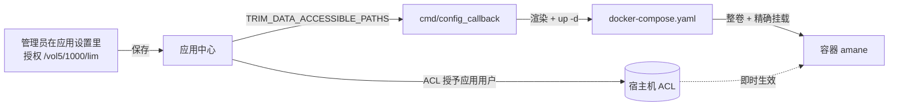

# 授权与权限边界

这篇说明「授权目录」在本应用里到底怎么落地、为什么选择路径有时点不进去，以及怎么验证。

## 三层边界

任何一层都不能单独保证安全，最终能不能读写由内核 ACL 决定：

| 层面 | 在本应用里的落地 | 作用 |
| --- | --- | --- |
| fnOS 授权目录 | 「应用设置 → 授权目录」授权，写入 `TRIM_DATA_ACCESSIBLE_PATHS`（冒号分隔） | 决定应用用户拿到哪些目录的 ACL（读写 / 只读） |
| Compose 挂载 | `docker-compose.yaml` 的 `volumes` | 决定容器里能看到哪些路径：`/data` + 整卷 `/volN` + 每个授权路径 |
| 容器运行身份 | `user: "<应用用户>:<应用组>"`（如 `962:956`） | 决定内核按谁的权限判 ACL —— **这才是真正的读写边界** |

因为容器进程就是 fnOS 应用用户，**没被授权的目录即使挂载了也读不到**（内核 ACL 直接拒绝），
只是目录名在容器里可见（不能列举、不能进入）。

## 授权是怎么落地的



关键点：

- 容器**整卷挂载**了 `/vol1`…`/volN`，所以新增授权目录**不需要重建容器**——ACL 在宿主机侧立刻生效。
- 每个授权目录还会被**精确挂载**一次（`/vol5/1000/lim:/vol5/1000/lim`），
  这样即使卷级 ACL 不允许穿越，容器也能直接访问到它。
- 容器身份由 `config/privilege` 的应用用户决定，并在 compose 里显式写成 `user: "<uid>:<gid>"`。

## `AMANE_SAFE_DIRS` 与三种取值

amane 自己有一层「安全目录」边界（`AMANE_SAFE_DIRS`），它决定：

1. 文件选择器的起点与可浏览范围；
2. 添加/修改媒体库时的路径校验范围。

它**只在容器创建时**写入，所以本包按以下优先级取值（由 `fpk/cmd/lib/compose.sh` 渲染）：

| 优先级 | 来源 | 取值 | 适用场景 |
| --- | --- | --- | --- |
| 1 | `/vol*/@appconf/amane/safe-dirs` 文件 | 文件内容（逗号分隔） | 想完全自定义边界 |
| 2 | 宽松模式 `AMANE_SAFE_MODE=permissive` | `ALLOW_ALL` | **容器没能自动重建时的回退**，避免新授权目录被旧列表挡住 |
| 3 | 精确模式（默认） | 已授权目录 + 数据目录 | 选择器默认落在第一个授权目录里，直接选中即可 |

队列永不为空：即使还没授权任何目录，也会写入数据目录，所以不会出现
`No safe directories configured.`。

## 为什么「选择路径」点不进去

这是 **fnOS 授权模型的固有行为，不是故障**：fnOS 只给**授权目录本身**读权限，
**父目录只给穿越（x）不给列举（r）**。在真机上用应用用户实测：

| 路径 | 授权情况 | `ls` 结果 |
| --- | --- | --- |
| `/` | 容器根目录 | ✅ 可列出 |
| `/vol1`、`/vol5` | 未授权 | ❌ Permission denied |
| `/vol1/1000`、`/vol5/1000` | 未授权 | ❌ Permission denied |
| `/vol1/1000/download`、`/vol5/1000/lim` | 已授权 | ✅ 可列出 |

于是：

- **手输完整路径**：服务端只做路径解析 + 存在性检查，只需要穿越权限 → **可用** ✅
- **选择器逐级点击**：从 `/` 点进 `/vol5` 时服务端要 `scandir('/vol5')` → 被拒 → 报错 ❌

用法建议：

1. **推荐**：默认的精确模式让选择器直接落在第一个授权目录里，打开就能选中；
   有多个授权目录时，用选择器自带的**路径输入框**粘贴绝对路径回车，再选中。
2. 任何时候都可以**直接手输**：在媒体库表单的路径框里填 `/vol5/1000/lim` 并保存。
3. 如果应用日志里没有 `已按最新配置重建容器 amane`（说明容器没被自动重建），
   compose 会退回宽松模式：选择器从 `/` 开始、点不进卷，但手输与选择器的路径输入框仍然可用。

一句话：**授权目录解决「能不能读写」，选择器解决「怎么挑路径」；fnOS 的授权不提供父目录遍历。**

## 验证授权是否真的落地

```bash
# ① 容器身份：应为应用用户与组（例如 962:956），而不是 1000:1000
sudo docker inspect amane --format '{{.Config.User}}'

# ② 挂载：应能看到 /data、/volN 整卷，以及授权目录本身
sudo docker inspect amane --format '{{range .Mounts}}{{printf "%s -> %s | RW=%v\n" .Source .Destination .RW}}{{end}}'

# ③ 安全目录取值
sudo docker exec amane env | grep AMANE_SAFE_DIRS

# ④ 真正的读写验证
sudo docker exec amane ls -la /vol5/1000/lim | head   # 能列出 = 授权生效
sudo docker exec amane ls /vol5 2>&1 | head -1        # 被拒 = 正常，不是故障
```

想要更省事：在仓库里执行 `sudo bash tools/doctor.sh`，它会把上面这些一次跑完并给结论。

## 更严格的做法

如果你希望连「看见」都不允许（容器里不出现未授权目录名），可以：

1. 在 `/vol*/@appconf/amane/safe-dirs` 写死允许的路径（逗号分隔）；
2. 从 `fpk/cmd/lib/compose.sh` 去掉整卷枚举（`for _v in /vol[0-9] /vol[0-9][0-9]` 那段），
   只保留授权目录的精确挂载，然后重新打包。

代价是：新增/取消授权后需要重建容器（日志会提示命令，或让生命周期脚本自己 `up -d`）。
