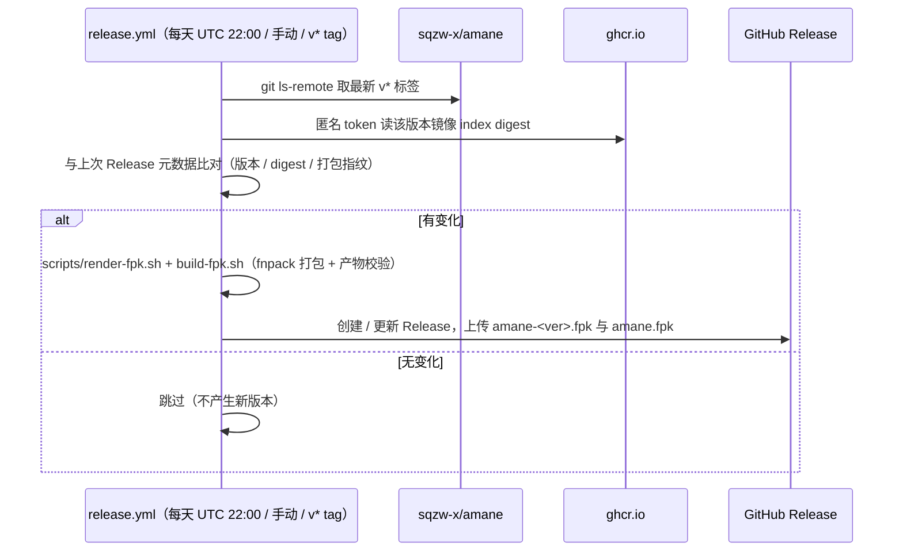

# 开发与发布

## 本地构建

Linux x86_64，需要 `bash`、`curl`、`python3`、`tar`，可选 `docker`（用于 Compose 语法校验）：

```bash
git clone git@github.com:frilxy/amane-fnos.git
cd amane-fnos

bash scripts/resolve-upstream.sh                       # 查看上游最新版本与镜像 digest
bash scripts/render-fpk.sh 0.18.0 ghcr.io/sqzw-x/amane:0.18.0
bash scripts/validate-fpk.sh                           # 静态校验 + 渲染器/Compose 校验
bash scripts/build-fpk.sh                              # 下载官方 fnpack 并打包

ls dist/                                               # dist/amane-0.18.0.fpk、dist/amane.fpk
```

也可以用 Makefile：

```bash
make check      # 只做校验
make fpk        # 校验 + 打包
make clean      # 清理 dist/ 与 .cache/
```

`fnpack` 版本与下载地址可用 `FN_PACK_VERSION` / `FN_PACK_URL` 覆盖；缓存目录 `CACHE_DIR` 默认 `.cache/`。
本地产物可用 `appcenter-cli install-fpk dist/amane.fpk` 在 fnOS 设备上安装测试。

## 工程结构

```text
fpk/            # fnpack 的输入（包内容）
  manifest      # 键值文件；version/changelog 由 CI 注入
  config/       # privilege（运行身份、附加组）与 resource（docker-project、data-share）
  app/docker/   # image（镜像地址）与 docker-compose.yaml（随包默认值）
  app/ui/       # 桌面入口与图标
  cmd/          # 生命周期脚本；cmd/lib/ 是共享实现
  wizard/       # 安装 / 配置 / 升级 / 卸载向导
scripts/        # CI 与本地构建：解析上游 → 渲染 → 校验 → 打包
tools/          # 面向 NAS 的运维脚本（如 doctor.sh，不进入 fpk）
docs/           # 文档
.github/        # build.yml（校验构建）· release.yml（定时发布）
```

### 关键实现约定

- `fpk/cmd/lib/compose.sh` 是**唯一的 Compose 生成器**：运行时由生命周期脚本调用，
  CI 里用同一份脚本生成随包默认文件，避免两份逻辑漂移。
  新增挂载 / 环境变量请只改这一处。
- 生成策略：
  - 身份 `user: "<TRIM_UID>:<TRIM_GID>"`
  - 数据目录 `${TRIM_DATA_SHARE_PATHS}:/data`
  - 整卷 `/volN`（跳过 `vol0*` 系统卷）+ 授权目录精确挂载 + `/etc/localtime:ro`
  - `AMANE_SAFE_DIRS` 三种来源（`etc/safe-dirs` > permissive > precise），见
    [AUTHORIZATION.md](AUTHORIZATION.md)
  - 端口 / 代理来自向导，持久化在 `${TRIM_PKGETC}/`
  - 随包默认文件用 `AMANE_COMPOSE_TEMPLATE=1` 生成：身份与数据目录写成 `${TRIM_*}` 占位，
    这样即使应用中心在 `install_callback` 之前就创建容器也不会用错身份。
- 生命周期脚本要求幂等：`status` 运行返回 0、未运行返回 3，未知参数返回 1；
  用户可见错误写 `TRIM_TEMP_LOGFILE`。改动前建议先读
  [飞牛应用开发文档](https://developer.fnnas.com/docs/guide/)。

### 校验脚本做了什么

`scripts/validate-fpk.sh`：

1. 必需文件齐全；
2. 所有 JSON（privilege / resource / ui / wizard）可解析；
3. manifest 字段、版本格式、入口与 `desktop_applaunchname` 一致；
4. 图标尺寸（64 / 256）与体积；
5. 生命周期脚本可执行且有 shebang；
6. 渲染器行为：注入非法 / 越权路径必须被拒绝，合法授权目录必须挂载，
   整卷挂载存在，`AMANE_SAFE_DIRS` 三种模式正确，代理设置 / 沿用 / 清除正确；
7. `docker compose config` 能解析生成的文件与随包默认文件。

## 发布流程



**版本号规则**

| 触发 | fpk 版本 | 例 |
| --- | --- | --- |
| 上游 `vX.Y.Z` 发版 | `X.Y.Z` | `0.18.0` |
| 同一版本镜像 digest 变化 | `X.Y.Z.N` | `0.18.0.1` |
| `fpk/**` / `scripts/**` 有改动 | `X.Y.Z.N` | `0.18.0.2` |
| 手动 `force` | `X.Y.Z.N` | — |

变更检测的「打包指纹」= 对 `fpk/**` 与 `scripts/**` 内容做哈希，写在 Release 正文的
HTML 注释里（`<!-- amane-fnos: {...} -->`），下一次运行时读回比对。
所以：**只改文档 / 工作流不会产生新版本**，改 `fpk/**` 或 `scripts/**` 才会。

**手动发布一版**

```bash
# 方式一：Actions → 构建并发布 fpk → Run workflow（可指定 upstream_version / force）
# 方式二：打 tag 推送（新标签会立刻触发发布）
git tag -a v0.18.0.6 -m "Amane 0.18.0.6 for fnOS"
git push origin v0.18.0.6
```

**注意**：GitHub 会在仓库连续 60 天没有提交活动后停用定时工作流（会提前发邮件提醒），
届时推一次提交或手动 dispatch 一次即可恢复。

## 测试清单

发布前建议在真机确认：

- [ ] 安装 / 覆盖升级 / 卸载（保留数据与删除数据两条路径）
- [ ] 授权目录后容器内可读：`docker exec amane ls -la <授权路径>`
- [ ] 端口、代理改动后容器自动重建（日志出现 `已按最新配置重建容器 amane`）
- [ ] 首次登录 Token 可取、网页可打开
- [ ] 停止 / 启动应用后 `docs/TROUBLESHOOTING.md` 中的体检脚本全绿
